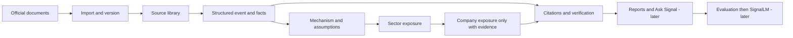

# SIGNAL V1 — locked working specification

Agreed build direction: 20 October 2026. Source of scope: Signal_AI_Political_Risk_Project_Plan.pdf, pages 2–9 (the user's master plan). Amend this specification explicitly when scope changes.

**User and question.** A research analyst investigating UK policy: what changed, through which economic channels could it matter, and which sectors or UK-listed companies have evidenced exposure? No trading or portfolio recommendations.

**V1 boundary.** UK government/parliamentary policy and economic announcements; UK equities as the eventual company universe. Energy and climate is the first test slice, not a replacement for the broader V1 scope. Start with existing models; SignalLM comes after a measured baseline.

**Evidence contract.** Preserve source URLs, publication/update/check dates, policy status, document version/hash and page references. Separate source facts from analytical inference. No company mapping without company-specific evidence; no precise effect size without evidence. A consultation is a proposal, not enacted law. Each impact carries assumptions, a countervailing mechanism, confidence with reasons, and evidence still needed. Confidence describes support for the mechanism, not a probability or expected return. AI-assisted examples need independent review before becoming gold labels.

**Event fields.** Stable slug; title; event_type; policy_area; jurisdiction; policy_status; event_date; source_updated_at; checked_at; source_url; document_url; document_sha256; deadline; summary; facts (id, statement, PDF page); targets (year, percentage, status, page); watchpoints; authorship and review status. The original publication is the event date; corrections are separate source updates.

**Impact fields.** Stable id; event foreign key; sector foreign key; controlled mechanism; direction (supportive/adverse/mixed/uncertain); time horizon; analytical explanation; fact references; confidence (low/medium/high) and rationale; assumptions; countervailing effects; missing evidence. Later company impacts add company identifier, source documents and materiality, never infer exposure from a name alone.

**Screens and jobs.** Now: source library and a reusable event-detail screen with fact → mechanism → sector chains. Next: automatic source imports, validated event extraction with an existing LLM, sectors/companies views, citation-backed reports and Ask Signal. Later: Evaluation and SignalLM pages. Log models, prompts, costs, latency and failures when model calls begin. Keep editorial input administrator-only until an authenticated editing workflow exists.

**Source expansion.** DESNZ GOV.UK first; Parliament and HM Treasury are the next candidate inputs, subject to source-specific verification. Five sources from one department do not satisfy the plan's 2–3-source automatic ingestion milestone.

**Success gates.** Current example: every factual statement has a checkable source/page; every mechanism is labelled inference and has caveats; proposal status is unmistakable; no unsubstantiated company claims; page, links and public read-only access work. Then: 100 documents produce validated event records with logged failures. Build an independently labelled 200–500-event evaluation set; measure classification, sector precision/recall, mechanism accuracy, unsupported claims, schema validity and retrieval quality. Compare SignalLM against the baseline fairly, including negative results.

**Non-goals.** Global coverage, social-media firehose, crypto/options, election prediction, trading, portfolio advice, price-event studies, richer fundamentals, multi-user watchlists and alerts. Retain these as V2 items from the master plan.

## Milestone audit
- Phase 0: this specification and schema establish the working baseline.
- Phase 1: source library plus one stored event and sector impact chain. Companies screens and a user-facing manual entry form are not yet built.
- Phase 2: daily refresh, bounded discovery of the five newest DESNZ feed entries, PDF text extraction and original PDF page navigation are implemented. Historical backfill, OCR/visual interpretation and 2–3 independent inputs remain outstanding. Current refreshes do not generate AI event records.
- Phases 3–7: AI extraction, transmission automation, RAG, evaluation and SignalLM remain outstanding.
- Hosting and visual work started early; this does not mean V1 or the portfolio definition of done is complete.

## Architecture

21 October 2026: AI extraction and graph/diagram interpretation deferred at the user’s request while API access and budget are unresolved. Original PDF links preserve access to visual evidence without claiming machine understanding.
